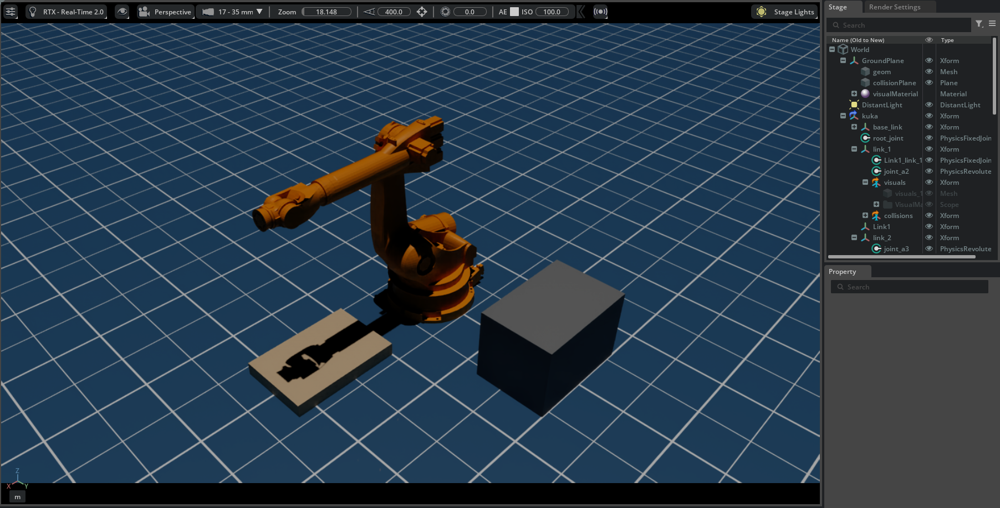

# KUKA KR210 Robotic Palletizing Cell — NVIDIA Isaac Sim 6.1

> **Work in progress.** Built step by step; each step is a separate, runnable script.

A robotic palletizing cell in NVIDIA Isaac Sim 6.1, built in standalone Python:
a KUKA KR210 industrial robot picks boxes from an infeed table and stacks them
on a Euro pallet.



## Current status

| Step | Description | Status |
|---|---|---|
| 1 | Launch Isaac Sim from standalone Python | Done |
| 2 | Load and inspect the KUKA KR210 (6 DOF, joints A1–A6) | Done |
| 3 | Cell layout: floor, lighting, pick table, Euro pallet, materials | Done|
| 4 | Motion control of the end effector (cuMotion / RMPflow) | Planned |
| 5 | Tool centre point and downward tool orientation | Planned |
| 6 | Vacuum (surface) gripper | Planned |
| 7 | Single-box pick-and-place | Planned |
| 8 | Pallet pattern generator and palletizing state machine | Planned |
| 9 | Validation runs with measured results | Planned |

## Tech stack
NVIDIA Isaac Sim 6.1 · Python · USD · PhysX · Git

## Cell layout
- Robot at the origin; pick table to its side, pallet in front (L-shaped cell, 90° apart)
- Euro pallet dimensions (1200 × 800 mm), table at 0.8 m working height
- All stations placed within the KR210's reach envelope

## Running
Requires Isaac Sim 6.1 (workstation install).

```bash
~/isaacsim/python.sh scripts/03_scene_setup.py
```

## Notes from development
- The Isaac Sim 6.1 Multiphysics KR210 asset ships with empty material scopes;
  the KUKA orange is applied programmatically via a PreviewSurfaceMaterial.
- Isaac Sim 6.1 deprecates the classic Core API; this project uses the new
  `isaacsim.core.experimental` API, based on NVIDIA's bundled 6.1 examples.
- Asset paths are case-sensitive: `Kuka` vs `KUKA` makes the difference between
  a loaded robot and an empty scene. Paths are copied from the Content browser
  rather than typed.